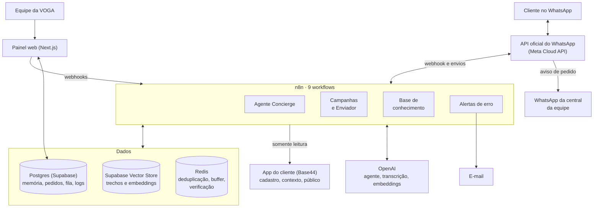
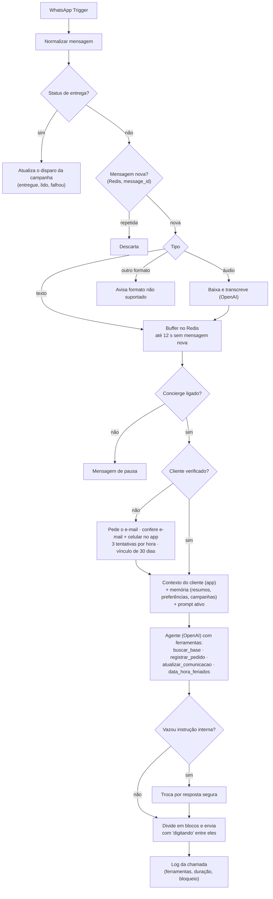
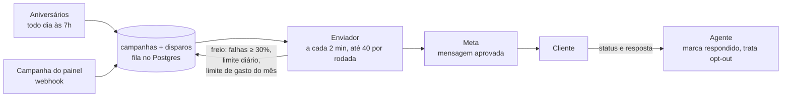

# VOGA Concierge: agente com IA para clientes premium

> Agente de WhatsApp que atende os clientes premium da VOGA Wealth, assessoria de investimentos, no programa de benefícios e experiências: tira dúvidas pela base de conhecimento, registra pedidos para a equipe e conversa sabendo o histórico de cada cliente. Inclui campanhas pela API oficial do WhatsApp e um painel web para a equipe operar tudo sem depender do desenvolvedor.

**Situação:** em implantação. O agente roda no número de teste da Meta e o painel está pronto, testado com dados fictícios. A troca para o número oficial da VOGA está em andamento.

---

## Problema

A VOGA oferece aos clientes de alta renda um app de benefícios e experiências (eventos, reservas, parceiros). As dúvidas e os pedidos sobre o programa chegavam pelos canais da equipe, sem registro e sem horário. O cliente premium espera resposta na hora, e a equipe precisava de uma forma de receber cada pedido sem perder nenhum.

<!-- TODO: Matheus revisar o texto do problema com o que o cliente relatou na descoberta (volume de mensagens, quem atendia antes, tempo de resposta). -->

## Solução

- **Agente no WhatsApp, a qualquer hora**, pela API oficial da Meta. Ele responde com as regras dos benefícios (RAG sobre os documentos do programa), registra pedidos e reconhece o cliente pelo histórico.
- **Só conversa com quem é cliente.** Antes da IA, o número passa por uma verificação: e-mail e celular precisam bater no mesmo cadastro do app.
- **Nenhum pedido se perde.** Cada pedido vira uma linha no banco e chega à central da equipe por WhatsApp em poucos minutos, com destaque quando há contexto financeiro.
- **Campanhas com freio.** Aniversários e campanhas com mensagens aprovadas pela Meta saem aos poucos, com pausa automática por falhas, limite diário e limite de gasto do mês.
- **Painel próprio** (Next.js) para a equipe acompanhar conversas e pedidos, criar campanhas, alimentar a base de conhecimento e editar o prompt do agente, com histórico de versões.

---

## Arquitetura

### Uma mensagem, do WhatsApp à resposta

### Campanhas

---

## Conceitos de IA aplicados

| Conceito | Como aparece no projeto |
|---|---|
| **Agente com ferramentas (tool calling)** | O modelo decide quando chamar `buscar_base` (RAG), `registrar_pedido` (grava o pedido no banco), `atualizar_comunicacao` (opt-out e opt-in das campanhas) e `data_hora_feriados` (data, feriado e horário da equipe). As descrições das ferramentas são parte do prompt. |
| **RAG** | Os documentos do programa são carregados, divididos com um *text splitter* recursivo, transformados em embeddings (`text-embedding-3-small`) e gravados no Supabase Vector Store. O agente busca os 4 trechos mais próximos da pergunta. |
| **Memória curta e longa** | Curta: as 10 últimas mensagens da conversa (Postgres). Longa: depois de cada conversa, a IA gera um resumo e extrai as preferências que o cliente declarou ("prefere mesa ao ar livre"). Os 3 últimos resumos e até 20 preferências entram no prompt das próximas conversas. |
| **Saída estruturada** | O resumo usa um *output parser* com esquema JSON (resumo, assuntos, pendências, preferências novas, oportunidades, "requer atenção"), para o resultado ir direto para o banco e para o e-mail. |
| **Prompt em camadas** | Regras de segurança fixas no nó → instruções que a equipe edita no painel (com histórico de versões) → dados da conversa entre marcações (`<dados_cliente>`, `<resumos_anteriores>`, `<campanhas_recentes>`). A equipe ajusta o tom e o conteúdo sem conseguir apagar as regras de segurança. |
| **Defesa contra prompt injection** | Tudo o que vem do cliente, das ferramentas e da memória é tratado como informação, nunca como instrução. A mensagem é limitada a 2.000 caracteres, os dados entram sem `<` e `>`, e a resposta passa por um filtro de vazamento antes de sair. O resumo passa por uma revisão que descarta preferências que pareçam instruções ("pode comentar meus investimentos"). |
| **Guardrails de domínio** | O agente não fala de investimentos nem executa ordens. Pedidos de resgate, transferência ou aplicação viram "falar com o assessor". Uma regra fixa, que não depende do que a IA concluiu, marca com **Atenção** o pedido e o resumo que mencionam movimentação financeira (resgate, PIX, TED, valores a partir de R$ 10 mil) e avisa que aquilo não vale como ordem. |
| **Transcrição de áudio** | Áudios do WhatsApp são baixados pela Graph API e transcritos (OpenAI, português) antes de entrar no buffer. |
| **Contexto de campanhas** | Quando o cliente responde a uma campanha, o agente recebe o texto que foi enviado nos últimos 15 dias e continua a conversa a partir dele, inclusive quando o cliente só toca num botão de resposta rápida. |

## Decisões técnicas

- **Buffer de mensagens no Redis:** no WhatsApp, o cliente manda a ideia em várias mensagens curtas. A execução que abriu a lista espera 12 s sem mensagem nova (ou 45 s desde a primeira) e responde uma vez ao texto completo. Um buffer parado há mais de 90 s é assumido pela mensagem seguinte, com trava para não responder duas vezes.
- **Deduplicação por `message_id`:** a Meta pode reenviar o mesmo webhook. Um contador no Redis (7 dias) garante uma resposta por mensagem.
- **Verificação antes da IA:** número sem vínculo não chega ao modelo. O vínculo vale 30 dias e a verificação tem limite de 3 tentativas por hora. Isso protege os dados do cliente e o custo de IA.
- **Somente leitura no sistema do cliente:** o n8n só consulta o app (cadastro, contexto e público das campanhas). Tudo o que o agente grava fica no banco do próprio projeto. Menos risco na primeira versão.
- **Fila de campanhas no banco, não um loop no n8n:** a fila sobrevive a reinícios, permite pausar e cancelar, impede envio em dobro e registra quem recebeu o quê (LGPD). A reserva do lote é atômica (`FOR UPDATE SKIP LOCKED`).
- **Freio automático nas campanhas:** pausa a campanha com 30% ou mais de falhas na última hora, respeita o limite diário e para tudo no limite de gasto do mês. O gasto é estimado com o que a Meta já informou mais o que ela ainda não informou, porque o relatório dela chega com horas de atraso.
- **Ingestão separada do agente:** a base de conhecimento tem um workflow próprio, que grava e confere a versão nova de um documento antes de apagar a anterior. Se a leitura falhar (PDF escaneado, por exemplo), a versão antiga continua valendo.
- **Aviso de pedido por WhatsApp com mensagem aprovada:** fora da janela de 24 h do WhatsApp, só um modelo aprovado pela Meta chega. O aviso tenta de novo em 10 minutos, até 3 vezes, e gera alerta se não sair.
- **Workflow de erro centralizado:** todos os workflows apontam para "Alertas de erro", que traduz o erro em linguagem simples, manda e-mail, registra no painel e agrupa alertas iguais (um a cada 15 minutos, pelo Redis).
- **Mensagens de campanha fora da tabela de conversas:** se cada disparo virasse "conversa", cada envio sem resposta geraria um resumo e um e-mail. O painel junta as duas fontes na tela da conversa.

## Os workflows

Os JSONs estão em [`workflow/`](./workflow). São 9 workflows, todos importáveis no n8n.

| Arquivo | Gatilho | O que faz |
|---|---|---|
| [`01-agente-concierge.json`](./workflow/01-agente-concierge.json) | WhatsApp Trigger · a cada 3 min | Atendimento completo (118 nós), status das campanhas, aviso de pedido à central, resumo das conversas e alerta de envios que não saíram |
| [`02-alertas-de-erro.json`](./workflow/02-alertas-de-erro.json) | Error Trigger | Monta o alerta, manda e-mail (sem repetir em 15 min) e grava na tabela `alertas` do painel |
| [`03-base-de-conhecimento.json`](./workflow/03-base-de-conhecimento.json) | Formulário do n8n · webhook do painel | Ingestão do RAG: carrega o documento, divide em trechos, gera embeddings e versiona |
| [`04-campanhas-enviador.json`](./workflow/04-campanhas-enviador.json) | A cada 2 min | Freio e manutenção, reserva do lote e envio pela Graph API |
| [`05-campanhas-aniversarios.json`](./workflow/05-campanhas-aniversarios.json) | Todo dia às 7h | Põe na fila os aniversariantes dos próximos 6 dias, com o presente do mês ou um presente exclusivo, e confere a qualidade do número na Meta |
| [`06-campanhas-campanha-do-painel.json`](./workflow/06-campanhas-campanha-do-painel.json) | Webhook do painel | Cria uma campanha com qualquer mensagem aprovada, para as categorias escolhidas, em modo teste ou para os clientes |
| [`07-painel-mensagens-da-meta.json`](./workflow/07-painel-mensagens-da-meta.json) | A cada 15 min · webhook do painel | Sincroniza as mensagens aprovadas da conta e cria mensagens novas para aprovação da Meta |
| [`08-painel-consumo-na-meta.json`](./workflow/08-painel-consumo-na-meta.json) | A cada 6 h | Lê o consumo e o custo na Meta (`pricing_analytics`) e alerta a 80% e 100% do limite do mês |
| [`09-painel-sincronizar-clientes.json`](./workflow/09-painel-sincronizar-clientes.json) | A cada 6 h | Copia nome, categoria e assessor dos clientes do app para o painel |

O resumo das conversas está implementado, mas **desligado nesta fase**: a saída de "Há conversas para resumir?" está desconectada no canvas, de propósito. As conversas continuam sendo encerradas e ficam na fila.

**Dados (Postgres):** `mensagens`, `vinculos_cliente`, `pedidos`, `resumos_conversa`, `preferencias_cliente`, `notificacoes_assessor`, `log_chamadas_ia`, `prompts_agente`, `config_agente`, `textos_agente`, `feriados`, `comunicacao_cliente`, `documentos`, `documentos_envios`, `trechos_documentos` (vetores), `campanhas`, `disparos`, `config_disparos`, `presentes_aniversario`, `presentes_aniversario_cliente`, `modelos_meta`, `meta_consumo`, `alertas` e `clientes_painel`. O esquema SQL não está neste repositório.

## O painel

Aplicação Next.js 16 (App Router, TypeScript) em que a equipe acompanha e opera o agente:

| Tela | O que faz |
|---|---|
| Início | Números do dia, situação do Concierge (verde, amarelo ou vermelho) e atividade recente |
| Conversas | Busca, filtros "com pedido aberto" e "requer atenção", balões do cliente, do agente e das campanhas |
| Pedidos | Cada pedido com os dados do cliente, o aviso à central e o atendimento pela equipe |
| Envios e Nova campanha | Campanhas com funil e progresso; criação com prévia, modo teste e confirmação |
| Presentes de aniversário | O presente de cada mês e os presentes exclusivos por cliente |
| Mensagens | Mensagens da Meta (aprovadas, em análise, recusadas) e criação de mensagens novas |
| Base de conhecimento | Envio e exclusão de documentos do RAG |
| Consumo | Gasto estimado do mês e limite que para as campanhas |
| Alertas | Erros em linguagem simples, com o que fazer |
| Configurações e Prompt do Agente | Interruptor, horários, feriados, mensagens automáticas e o prompt com histórico de versões |

**Como foi construído:**
- **Lógica só no servidor.** O navegador só mostra o que recebe pronto e devolve o que a pessoa escolhe. Nenhuma chave do banco ou do n8n vai para o navegador; o build falha se um componente de navegador importar código do servidor.
- **Permissão mínima no banco.** O painel usa um usuário próprio, que só lê as tabelas do agente e só escreve por funções que conferem o perfil e gravam a auditoria. As tabelas têm RLS.
- **"Ao vivo" sem Realtime:** cada tela pergunta ao servidor a versão dos seus dados (a cada 4 s numa conversa aberta) e só recarrega quando algo muda.
- **Três perfis** (equipe, administrador e suporte técnico) e sessão que expira em 12 horas sem uso.

O código do painel fica num repositório privado.

## Stack

**Workflows:** n8n (self-hosted) · API oficial do WhatsApp (Meta Cloud API / Graph API) · OpenAI (modelo do agente `gpt-6-luna`, embeddings `text-embedding-3-small` e transcrição de áudio) · Supabase (Postgres e Vector Store) · Redis · Base44 (app do cliente, via funções HTTP) · Gmail

**Painel:** Next.js 16 · TypeScript · Postgres (`pg`) · Supabase Auth e Storage

## Testes

- **13 cenários de ponta a ponta** no número de teste da Meta (outubro de 2026), com relatório.
- **Código dos nós** testado fora do ambiente real, num Postgres local (PGlite) com dados fictícios. Nada roda contra clientes reais: as campanhas têm modo teste, que só envia aos números da equipe.
- **Painel:** testes de tela, de rotas e de navegador (Chrome sem tela, controlado pelo DevTools Protocol), contra um n8n falso. Teste de volume com 3 mil clientes, 300 mil mensagens, 120 mil disparos e 150 mil respostas da IA, medindo cada consulta.

## Resultado

<!-- TODO: Matheus preencher com números reais depois da virada para o número oficial (conversas por semana, pedidos registrados, tempo até a central receber o pedido, horas da equipe economizadas). Não estimar. -->

## Demo

**O Concierge em 79 segundos (sem áudio).** Uma conversa no WhatsApp e, depois, a equipe usando o painel: login, pedidos, uma mensagem nova para aprovação da Meta, uma campanha, o consumo do mês e as configurações do agente. O painel está em modo demonstração, com dados fictícios.

<!-- VÍDEO: no github.com, edite este arquivo, apague esta linha inteira e arraste aqui o arquivo voga-concierge-github.mp4. O GitHub troca pelo link do vídeo e mostra o player. -->

<!-- TODO: print do canvas do n8n (assets/canvas.png). -->

---

## Como importar os workflows

1. No n8n, **Workflows → Import from File** e escolha os arquivos de `workflow/`.
2. Crie as credenciais e selecione-as nos nós: Postgres, Redis, OpenAI, Supabase API, WhatsApp (Meta; o trigger usa a credencial OAuth do app), Gmail OAuth2 e Header Auth (uma para as funções do app do cliente, outra para o header `x-painel-token` dos webhooks do painel).
3. Troque os placeholders:

| Placeholder | Onde | O que é |
|---|---|---|
| `{{URL_DO_APP_DO_CLIENTE}}` | Nós "Base44" de 01, 05, 06 e 09 | Endereço das funções de backend do app do cliente (`validarCliente`, `contextoCliente`, `publicoDisparos`) |
| `{{META_PHONE_NUMBER_ID}}` | 01, nó "Config: resumo ao assessor" | ID do número da Meta que envia o aviso de pedido |
| `<WHATSAPP_DA_CENTRAL>` | 01, mesmo nó | WhatsApp da central, usado se a configuração do painel estiver vazia |
| `<EMAIL_DOS_RESUMOS>` | 01, mesmo nó | Caixa que recebe os resumos, usada se a configuração do painel estiver vazia |
| `{{DOMINIOS_DE_EMAIL_PERMITIDOS}}` | 01, mesmo nó | Domínios aceitos como destino de e-mail |
| `{{EMAIL_DOS_ALERTAS}}` | 02, nó "Enviar alerta por e-mail" | Quem recebe os alertas de erro |

Dentro de expressões do n8n, que já usam `{{ }}`, o placeholder aparece como `<NOME>` para não quebrar a expressão.

4. Em cada workflow, **Settings → Error workflow → "Agente Concierge · Alertas de erro"**.
5. Crie as tabelas listadas em "Os workflows" e a função `match_trechos_documentos` (busca vetorial) no Postgres.

## O que foi tirado destes arquivos

Os workflows saíram do n8n de produção e foram sanitizados antes de entrar aqui: sem credenciais, IDs de workflow e de instância, `webhookId`, `pinData` e dados de execução; sem URLs e domínios do cliente e do servidor; sem telefones, e-mails e IDs da Meta. Nos JSONs, o nome do cliente ficou genérico ("corretora"), e as categorias do programa viraram Bronze, Prata, Ouro e Diamante. No filtro de vazamento, as faixas de patrimônio reais deram lugar a um padrão genérico. As notas do canvas foram revisadas para descrever a versão atual. A única URL que ficou é a da Graph API da Meta (`graph.facebook.com`), que é pública e igual para qualquer conta.
