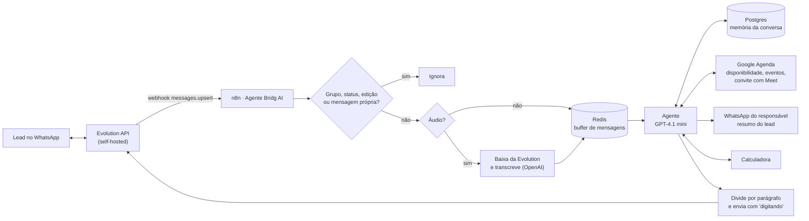

# Agente de atendimento da Bridg AI

> O agente que atende quem chega à Bridg AI pelo WhatsApp: entende o negócio da pessoa, mostra o que um agente faria por ela, marca uma reunião de diagnóstico na agenda e passa o resumo do lead para o responsável. Está no ar e pode ser testado.

💬 [Conversar com o agente](https://wa.me/5561991174763?text=Oi%21%20Vim%20pelo%20GitHub%20e%20quero%20testar%20o%20agente%20da%20Bridg%20AI)

---

## Problema

Quem chega a uma consultoria pequena manda mensagem a qualquer hora, geralmente sem saber o que perguntar. Fora do horário comercial, a conversa esfria antes de alguém responder. E quem procura uma empresa que constrói agentes quer ver um agente funcionando, não ler sobre ele.

## Solução

Um agente no WhatsApp que atende 24 h e conduz a conversa: descobre o ramo da pessoa, dá exemplos daquele setor e traduz tudo em impacto no negócio. Quando faz sentido, consulta a agenda real, marca a reunião de diagnóstico com convite e Google Meet, e manda ao responsável um resumo do lead (negócio, dor, sistemas, interesse). O próprio atendimento é a demonstração do produto.

## Arquitetura

O JSON está em [`workflow/agente-bridg-ai.json`](./workflow/agente-bridg-ai.json) (38 nós, com as notas do canvas).

## Conceitos de IA aplicados

| Conceito | Como aparece no projeto |
|---|---|
| **Agente com ferramentas (tool calling)** | Cinco ferramentas: `verificar_disponibilidade`, `buscar_agendamentos` e `criar_agendamento` (Google Agenda), `notificar_matheus` (HTTP para a Evolution API, com o resumo do lead) e `calculadora`. Os parâmetros são preenchidos pelo modelo (`$fromAI`), com descrição de cada campo, como "início em ISO 8601 com fuso -03:00". |
| **Prompt engineering** | O prompt define a missão em três papéis (mostrar o que dá para fazer, ser a prova de que funciona, traduzir em impacto), o tom de WhatsApp (2 a 4 linhas, uma pergunta por vez), exemplos certo × errado, exemplos por setor e regras invioláveis. |
| **Contexto dinâmico no prompt** | Data e hora de Brasília, nome e telefone do lead entram no prompt a cada mensagem, para o agente marcar reuniões no dia certo e não pedir o que já sabe. |
| **Memória de conversa** | As 20 últimas mensagens por telefone, no Postgres (`memoryPostgresChat`). |
| **Guardrails no prompt** | Não informa preço, não inventa números, funcionalidades nem cases, não finge ser humano, não cita clientes e só diz que marcou ou avisou depois que a ferramenta confirmou. Contas de impacto só com os números que a própria pessoa informou, apresentadas como estimativa. |
| **Transcrição de áudio** | Áudio baixado da Evolution em base64, convertido em arquivo e transcrito (OpenAI, português). |
| **Handoff para humano** | Quando a pessoa pede alguém, insiste em preço ou o projeto está definido, o agente oferece a reunião ou resume o que entendeu, pede confirmação e só então avisa o responsável. |

## Decisões técnicas

- **Buffer no Redis:** cada mensagem entra numa lista por telefone; só a execução que abriu a lista segue e espera 12 s sem mensagem nova antes de juntar tudo. O agente responde uma vez à ideia completa, e não a cada pedaço.
- **Filtro na entrada:** descarta grupos, status, listas de transmissão, edições, reações, enquetes e as mensagens enviadas pelo próprio número, antes de gastar qualquer chamada de IA.
- **"Digitando" enquanto a IA pensa** e entre os blocos da resposta, com duração proporcional ao tamanho do texto. A resposta é dividida por parágrafo e o `**negrito**` do Markdown vira o `*negrito*` do WhatsApp.
- **Evolution API em servidor próprio:** dá controle total da instância e do webhook. Os dados de conexão (endereço e chave) chegam no próprio evento e são reaproveitados nos nós seguintes, sem chave escrita no workflow.
- **Resumo do lead em formato fixo** (nome, telefone, negócio, dor, sistemas, interesse, impacto estimado, motivo), para o responsável assumir a conversa sem reler tudo.

## Stack

n8n · Evolution API · OpenAI (GPT-4.1 mini e transcrição de áudio) · Redis · Postgres (Supabase) · Google Agenda

## Resultado

<!-- TODO: Matheus preencher com números reais (conversas atendidas, reuniões marcadas pelo agente, leads encaminhados). Não estimar. -->

## Demo

<!-- TODO: print ou GIF de uma conversa de teste (assets/conversa.png), sem dados de terceiros, e print do canvas (assets/canvas.png). -->

---

## Como importar

1. No n8n, **Workflows → Import from File** e escolha `workflow/agente-bridg-ai.json`.
2. Crie as credenciais e selecione-as nos nós: Redis, Postgres, OpenAI, Google Calendar OAuth2 e Evolution API.
3. Troque os placeholders:

| Placeholder | Onde | O que é |
|---|---|---|
| `{{ID_DA_AGENDA_GOOGLE}}` | `verificar_disponibilidade`, `buscar_agendamentos`, `criar_agendamento` | A agenda em que as reuniões são marcadas |
| `{{WHATSAPP_DO_RESPONSAVEL}}` | `notificar_matheus` | Número que recebe o resumo do lead |
| `<SITE_DA_EMPRESA>`, `<TELEFONE_DE_CONTATO>`, `<EMAIL_DE_CONTATO>` | Prompt do nó "Agente Bridg AI" | Contatos que o agente passa ao lead |

Dentro de expressões do n8n, que já usam `{{ }}`, o placeholder aparece como `<NOME>` para não quebrar a expressão.

4. Na Evolution API, aponte o evento `messages.upsert` da instância para a URL de produção do webhook.

## O que foi tirado deste arquivo

Credenciais, `webhookId`, IDs da instância, o caminho real do webhook, o telefone e o e-mail do responsável, o ID da agenda e o endereço do site. Os nós com nomes genéricos foram renomeados ("Convert to File1" virou "Converter áudio em arquivo") e as notas do canvas foram reescritas para explicar cada bloco.
