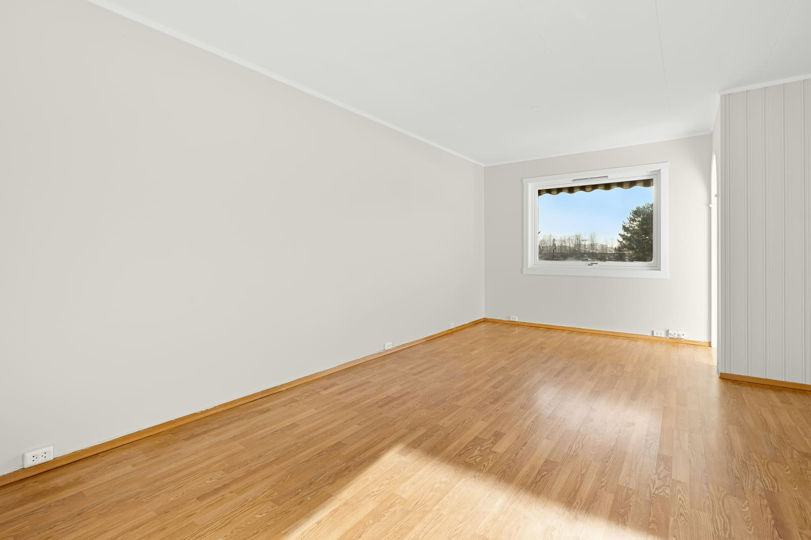
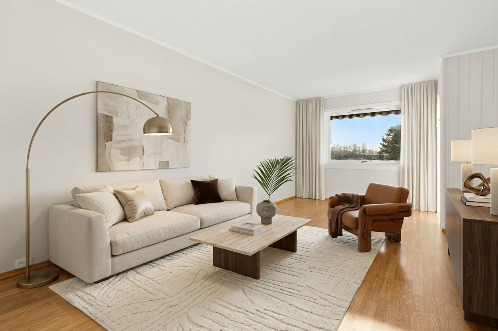
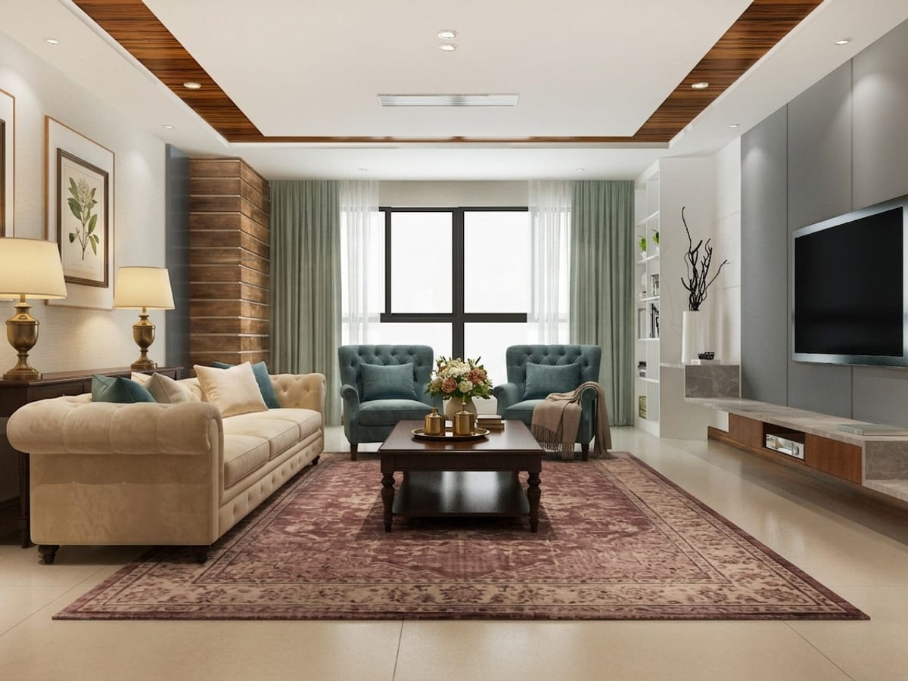
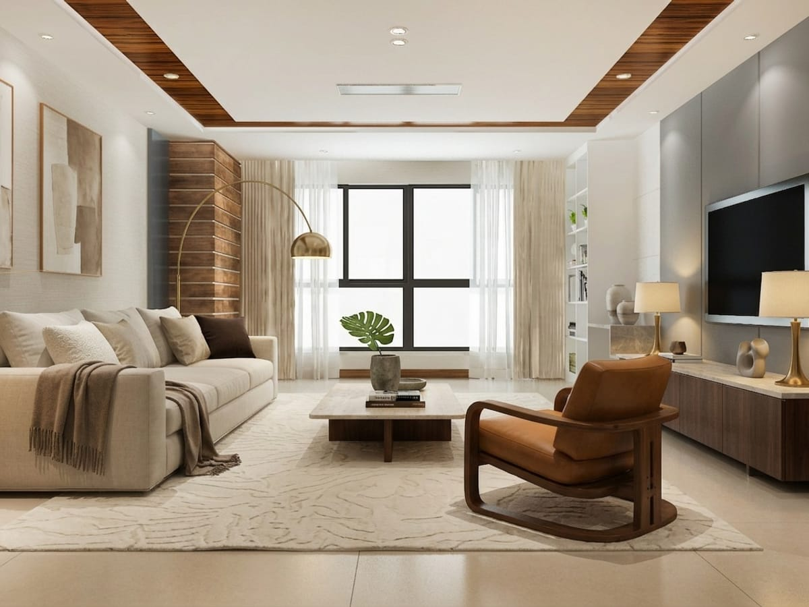

# Vistera: staging virtual com IA para imóveis

> Produto próprio, construído do zero: o corretor envia a foto do cômodo vazio e recebe o ambiente mobiliado em segundos, preservando paredes, janelas e o ângulo da câmera. Inclui análise de mercado pelo endereço e proposta para o cliente com PDF.

🔗 [Conhecer a plataforma](https://vistera-gamma.vercel.app)

---

## Problema

Imóvel vazio vende mal pela foto: quem vê o anúncio não consegue imaginar o espaço mobiliado. Mobiliar de verdade para fotografar custa caro e leva tempo, e o corretor precisa mostrar o mesmo imóvel para perfis de comprador diferentes.

<!-- TODO: Matheus revisar o problema com o que ouviu das imobiliárias. -->

## Solução

- **Staging virtual de interiores:** mobiliar ou esvaziar um cômodo a partir da foto do corretor, em 10 estilos e 9 tipos de ambiente.
- **A mesma sala para dois compradores:** o mesmo cômodo em estilos diferentes, a partir da mesma foto.
- **Área externa:** piscina, jardim, deck e fachada.
- **Análise de mercado pelo endereço**, com laudo em PDF.
- **Proposta para o cliente final** por link público, com PDF.

Vendido às imobiliárias como sistema, com implantação e mensalidade.

## Antes e depois

Imagens geradas pelo próprio produto, sem retoque: à esquerda, a foto que o corretor enviou; à direita, o resultado.

| Foto enviada | Ambiente gerado |
|---|---|
|  |  |

**A mesma sala, dois compradores:**

| Clássico | Alto padrão |
|---|---|
|  |  |

## Conceitos de IA aplicados

- **Geração de imagem que preserva a estrutura:** a IA mobilia o cômodo sem mexer nas paredes, nas janelas nem no ângulo da câmera, para a foto continuar fiel ao imóvel.
- **Dez estilos calibrados**, para o resultado ser consistente entre fotos e corretores.

<!-- TODO: Matheus descrever o modelo de geração de imagem usado, como a estrutura do cômodo é preservada (máscara, referência, controle) e como a análise de mercado é calculada. -->

## Stack

<!-- TODO: Matheus preencher (framework, banco, modelo de imagem, geração do PDF). Hospedagem confirmada: Vercel. -->

## Resultado

<!-- TODO: Matheus preencher com números reais (imobiliárias usando, imagens geradas, tempo por imagem). Não estimar. -->
