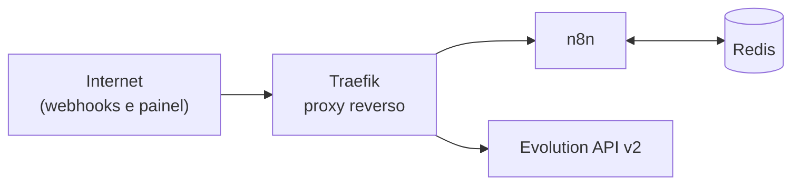

# Infraestrutura self-hosted

> Servidor próprio (VPS) com n8n, Evolution API v2, Traefik e Redis em contêineres. É a base dos agentes deste portfólio.

## O que roda aqui

- **n8n:** orquestra os agentes e as automações (webhooks, agendadores e chamadas às APIs).
- **Evolution API v2:** conexão com o WhatsApp usada pelo agente da Bridg AI.
- **Traefik:** proxy reverso na frente dos serviços.
- **Redis:** estado de curto prazo dos agentes (buffer de mensagens, deduplicação e travas).

O agente concierge usa a API oficial do WhatsApp (Meta Cloud API), que não passa pela Evolution.

<!-- TODO: Matheus. A configuração do servidor não estava na máquina usada para montar este repositório. Falta:
- docker-compose.yml sanitizado (domínios, e-mails do certificado, senhas e chaves como variáveis, com um .env.example só com os nomes);
- o problema de conexão do WhatsApp que foi resolvido na Evolution API e como;
- como é feito o backup e a atualização dos contêineres.
Antes de subir o compose, rodar gitleaks e conferir à mão que nenhum domínio ou chave ficou no arquivo. -->
